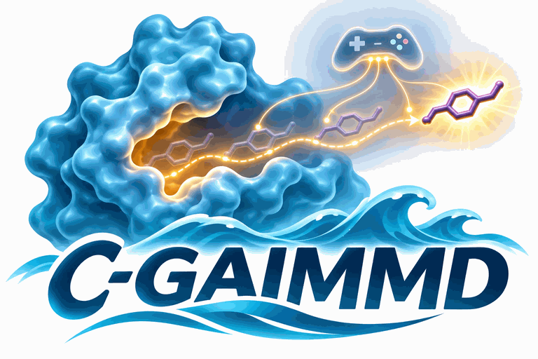

C-GAIMMD user guide
===================

**Committor-conditioned Generative AIMMD (C-GAIMMD)** is the path type
``chain_type='cgaimmd'`` of AIMMD. In an RFPS or TPS run, a shooting worker
picks its shooting point among the frames of earlier paths. In a C-GAIMMD run,
the shooting point is *generated*: a generative model, conditioned on the
committor, produces configurations at a committor value the worker asks for,
and the worker shoots from one of them. Everything after the shooting point
(the two-way shot, registration, the trainer, the adaptive bins and the
reweighting) is AIMMD's RFPS machinery, unchanged.

This page explains what C-GAIMMD does and how to configure it. How to run a
campaign on a workstation or a cluster is in :doc:`cgaimmd_production`; the
messages of the start-up checks and their fixes are in
:doc:`cgaimmd_troubleshooting`; the details of every part are in
:doc:`cgaimmd_internals`. Tutorial 3 (:doc:`tutorials/3_cgaimmd_toy_1d`) runs
a complete C-GAIMMD campaign on a toy system in about a minute on a CPU.

.. contents:: On this page
   :local:
   :depth: 1

Terms used on this page
-----------------------

Committor
   :math:`p_B(x)`, the probability that a trajectory started from configuration
   :math:`x` with random velocities reaches the state ``states[2]`` (B) before
   ``states[0]`` (A). It is 0 in A, 1 in B and 1/2 on the transition state
   ensemble.
Logit committor
   :math:`\lambda = \log\left(p_B / (1 - p_B)\right)`. AIMMD's networks output
   :math:`\lambda`; every committor value on this page is a logit. :math:`\lambda
   = 0` is the transition state ensemble, :math:`\lambda = \pm 2` is a committor
   of about 0.12 or 0.88, and :math:`\lambda = \pm 10` is deep in a state.
Target committor
   :math:`\lambda^*`, the committor value a shooting worker asks the generator
   for.
Generator
   The method that turns target committors into candidate configurations, for
   example the flow-matching ODE of a PaiNN network or BioEmu2's diffusion
   sampler.
Candidate
   One generated configuration on its way to becoming a shooting point.
Generator atoms
   The atoms a generator produces, in a fixed order: the solute (or the whole
   system in vacuum), optionally with a fixed number of nearby waters.
Sidecar
   The record ``path<n>.xtc.cgaimmd.json`` written next to every C-GAIMMD shot.

What C-GAIMMD does, and why
---------------------------

An AIMMD run learns the committor while it samples, and it chooses shooting
points near the transition state ensemble because that is where shots are most
informative. With RFPS, those shooting points must be frames of paths already
in the ensemble. Early in a run, and for transitions whose transition states
are rarely visited, few such frames exist, and the run spends shots on frames
that are only approximately where it wants them.

C-GAIMMD removes that restriction. Its network carries, next to the committor,
a generator conditioned on the committor. The shooting worker draws a target
:math:`\lambda^*` (by default uniformly in a window around the transition
state), generates candidates at that target, and shoots from a candidate whose
committor, measured by the network on the prepared structure, is within a
tolerance of the target. The trainer then trains both the committor and the
generator on the new shots. The committor tells the generator where the
transition states are; the generator lets the run shoot there whether or not a
path has visited the place.

Two things are the same as in RFPS:

- every shot is an unbiased two-way shot with fresh Maxwell-Boltzmann
  velocities, and it is registered and reweighted exactly like an RFPS shot;
- the committor network is an ordinary AIMMD network: its ``forward`` is used
  by every value pass, the bins, the densities and the reweighting.

One thing is different: the shooting points are not frames of the path
ensemble, and the probability with which a configuration becomes a shooting
point (the *shooting-point law*) is not known in closed form. AIMMD's own
reweighting does not need to know how many shooting points sit at each
committor value, so free energies and rates come from the trainer's
reweighting as in an RFPS run; it does assume that, at each committor value,
the shooting points resemble equilibrium configurations, which is what the
generator is trained toward and what its validation measures. Estimators that
need the shooting-point law, such as exact path importance sampling or path
MBAR, do not apply. The sidecars record everything about each shooting point,
so that the law can be studied afterwards. :doc:`cgaimmd_analysis` explains
which estimators apply and why.

To repeat the trainer's reweighting after a run (per-frame equilibrium
weights, populations, free energies along any collective variable, rates from
part of the data), use :func:`aimmd.analysis.reweighting.reweight_run`; rates
counted in the free simulations alone are in :mod:`aimmd.analysis.free_md`.
The tools that judge the committor model and the generator (parity against
brute-force shooting, generator adherence, shooting validation of generated
configurations) are described in :doc:`api/cgaimmd_analysis`; how to make each
analysis of a run is shown in :doc:`cgaimmd_analysis` and in tutorial 7
(:doc:`tutorials/7_cgaimmd_analysis`).

How one shot is made
--------------------

A C-GAIMMD shooting worker obtains each shooting point in two stages and a
final check:

1. **Refill** (stage 1, one batch). When its pool of candidates is empty, the
   worker draws ``n_targets`` target committors from the *target law*, asks the
   generator for ``candidates_per_target`` candidates per target, drops
   candidates with non-finite coordinates, runs ``cgaimmd_validity_function``
   (bond graph, chirality, clashes, a polish) and computes the committor of
   every survivor (the *raw* committor). The survivors go into the pool.
2. **One candidate** (stage 2). The worker pops a random candidate from the
   pool and prepares it: ``cgaimmd_prepare_function`` puts it into the run's
   full system (for example by re-solvation), and ``cgaimmd_minimize_function``
   runs a restrained energy minimization. Without a preparation function the
   candidate is placed in the run's box.
3. **Final acceptance check.** The worker computes the state and the committor
   of the prepared frame, exactly as grompp will receive it. The frame must be
   in the reactive region R and, once the network has been trained on enough
   shots, its committor must be within ``lambda_tolerance`` of the candidate's
   target. A candidate that fails is discarded and the next one is popped.
4. **The shot.** The accepted frame becomes the shooting point of an ordinary
   two-way shot. Before the segments start, the worker writes an *in-flight
   record* into the chain folder; after registration, that record becomes the
   path's sidecar.

The pool holds candidates of one network only. When the trainer saves a new
network, the next pop resets the pool, so shots always come from the current
generator. A refill that was outdated while it was being generated serves one
pop before the reset, so that a refill slower than a training round still
produces shots. After ``max_refills`` refills without an accepted candidate,
the worker prints a warning and waits ``wait_seconds`` before it tries again;
it never stops for want of a candidate.

Choosing a generator
--------------------

How candidates are generated is set by ``cgaimmd_generator``. Two methods are
built in:

.. list-table::
   :header-rows: 1
   :widths: 16 42 42

   * -
     - ``'ode'``
     - ``'bioemu2_edm'``
   * - Model
     - A flow-matching network: the PaiNN network
       :class:`~aimmd.cgaimmd.flow_matching.painn.JointPaiNN` (or the toy
       :class:`~aimmd.cgaimmd.flow_matching.toy.TinyFlowNetwork`), with a
       committor head and a velocity field that share one trunk.
     - BioEmu2, Microsoft's protein ensemble emulator, frozen, with small
       trunk adapters that condition it on the committor, and a committor head
       on BioEmu2's own features
       (:class:`~aimmd.cgaimmd.bioemu2.network.BioEmu2Network`).
   * - How it generates
     - Integrates the ODE of the velocity field from a Gaussian prior sample
       to a configuration at :math:`\lambda^*`.
     - Runs BioEmu2's diffusion (EDM) sampler on the adapted trunk embeddings,
       then completes hydrogens, ions and other atoms BioEmu2 does not model
       from a template.
   * - Systems
     - Any molecule with a GROMACS topology: small molecules, host-guest
       complexes, peptides, optionally with a cluster of waters.
     - Proteins and protein-ligand complexes that BioEmu2 can model.
   * - What is trained
     - The whole network, every round from the end-state pretraining
       (:func:`~aimmd.cgaimmd.flow_matching.fit.flow_matching_fit`).
     - The committor head first, then the adapters, both from reset every
       round (:func:`~aimmd.cgaimmd.bioemu2.fit.sequential_fit`).
   * - Settings
     - ``sampler`` (``'euler'``, ``'midpoint'``, ``'rk4'``; default
       ``'midpoint'``), ``n_steps`` (16), ``chunk`` (128 samples per call),
       ``guidance_scale`` (1.0)
     - ``n_steps`` (200), ``cfg_scale`` (1.0), ``cfg_schedule`` (None),
       ``chunk`` (16)
   * - Install
     - the ``cgaimmd`` extra
     - the ``bioemu2`` or ``bioemu2-cuda`` extra (Python 3.12 or later); the
       production model runs on NVIDIA GPUs
   * - Tutorials
     - :doc:`tutorials/3_cgaimmd_toy_1d`, :doc:`tutorials/4_cgaimmd_painn_nanma`
     - :doc:`tutorials/5_cgaimmd_bioemu2_chignolin`,
       :doc:`tutorials/6_cgaimmd_bioemu2_trypsin_benzamidine`

The PaiNN network is E(3)-equivariant by default, so it treats a structure and
its mirror image alike. With ``parity_breaking=True`` it becomes
SE(3)-equivariant (sometimes called Chiro-PaiNN) and can generate the right
enantiomer of every stereocenter; use it for chiral molecules. With the E(3)
network, set ``reflect_mirror_images=True`` in the validity check instead, so
that mirror images are reflected back rather than rejected.

Both methods offer *classifier-free guidance*: the generated sample follows
:math:`w \, v_{\text{cond}} + (1 - w) \, v_{\text{uncond}}`, a mix of the field
conditioned on :math:`\lambda^*` and the field without a condition, with the
guidance weight :math:`w` (``guidance_scale`` for ``'ode'``, ``cfg_scale`` for
``'bioemu2_edm'``). :math:`w = 1` is no guidance. Larger weights push samples
harder toward the requested committor and usually cost variety. The
unconditioned field must have been trained: the flow-matching fit drops the
label of 15 % of its samples by default (``p_uncond``); a BioEmu2 network needs
``learned_null=True`` and a fit with ``p_uncond > 0``, or guidance against
plain BioEmu2 (a ``cfg_schedule`` with the null ``'bioemu2'``).

``cgaimmd_generator`` takes one of these values:

- a method name, for example ``'ode'``;
- a settings dict, for example ``{'method': 'ode', 'sampler': 'midpoint',
  'n_steps': 16, 'chunk': 128}``;
- a settings dict without ``'method'``, which changes settings of the
  network's default method;
- a generator object (saved as its settings dict when its method is
  registered);
- None (the default): the network's ``default_generator()`` decides
  (``'ode'`` for ``JointPaiNN`` and ``TinyFlowNetwork``, ``'bioemu2_edm'`` for
  ``BioEmu2Network``).

A name or a settings dict is the safest value, because the workers load the
params from the saved file. The generator is built and checked against the
network when the params load, when a shooting worker starts and in the
preflight. Its method and settings are written into every sidecar.

Adding a generation method
~~~~~~~~~~~~~~~~~~~~~~~~~~

A generator is any object with a string ``method`` and three methods:

``check(network) -> list of str``
   What the method needs from the network and does not find, one message per
   problem; an empty list when the network can be used. It must be cheap and
   must not raise for a network that lacks something.
``generate(network, lam, *, generator=None) -> torch.Tensor``
   ``lam`` is a ``(B,)`` tensor of target logit committors on the network's
   device. Return ``(B, M, 3)`` coordinates in Ångström on the same device,
   one candidate per entry of ``lam``, without autograd history. ``generator``
   is the ``torch.Generator`` of the worker's random stream: draw every random
   number from it, so that a refill can be reproduced.
``settings() -> dict``
   The settings, JSON-serializable. ``{'method': method, **settings()}`` must
   rebuild an equal generator.

Register it with :func:`~aimmd.cgaimmd.generation.register_generator`, in the
params file or in a module the params file imports, so that every worker
that loads the params registers it too:

.. code-block:: python

    import torch
    from aimmd.cgaimmd.flow_matching.sampler import from_flow
    from aimmd.cgaimmd.generation import register_generator

    class PriorJitter:
        """Prior samples with extra Gaussian noise: a baseline that ignores the committor."""
        method = 'prior_jitter'

        def __init__(self, sigma=0.1):
            self.sigma = float(sigma)

        def check(self, network):
            if callable(getattr(network, 'sample_prior', None)):
                return []
            return ['prior_jitter needs sample_prior(lam, n, *, generator=None)']

        def generate(self, network, lam, *, generator=None):
            with torch.no_grad():
                x = from_flow(network, network.sample_prior(lam, len(lam), generator=generator))
                return x + self.sigma * torch.randn(x.shape, generator=generator, device=x.device)

        def settings(self):
            return {'sigma': self.sigma}

    register_generator('prior_jitter', PriorJitter)
    cgaimmd_generator = {'method': 'prior_jitter', 'sigma': 0.2}

Registering the same class again (the params file is executed again on every
load) does nothing. A new method that should ship with AIMMD-Lab goes into the
package and registers itself when its module is imported, as
:mod:`aimmd.cgaimmd.flow_matching.sampler` and
:mod:`aimmd.cgaimmd.bioemu2.sampling` do. Tutorial 3 registers a generator of
its own and runs shots with it.

The network
-----------

A C-GAIMMD network is the committor model of the run. It needs AIMMD's usual
members (``forward``, ``state_dict``, ``load_state_dict``, ``parameters``,
``to``, ``eval``, ``train``) and an attribute ``n_atoms``, the number of
generator atoms. ``forward`` takes the descriptors (the flat Ångström
coordinates of the generator atoms, shape ``(B, 3 M)``) and returns the logit
committor toward ``states[2]``, shape ``(B, 1)``. Optional members are
``default_generator()``, ``lambda_clip`` (the conditioning range :math:`L`:
targets beyond :math:`\pm L` are clipped), ``reset_parameters()``,
``committor(x)`` and ``provenance()``. What a generation method needs beyond
that (for ``'ode'``: ``velocity`` and ``sample_prior``) is checked by the
method itself. :func:`~aimmd.cgaimmd.protocol.check_network_protocol` lists the
contract in full.

The network must be an instance of a class *defined in the params file* (a
subclass is enough), because AIMMD's saved copy of the params file imports it
from there:

.. code-block:: python

    from aimmd.cgaimmd.flow_matching.painn import JointPaiNN

    class Network(JointPaiNN):
        pass

    network = Network.from_topology('topol.top', DESCRIPTORS, embedding='element',
                                    topology_edges=True, parity_breaking=True, ...)

The trainer calls the params file's ``fit`` once per round. A C-GAIMMD ``fit``
wraps the trainer of its model, with the keywords of the run:

.. code-block:: python

    from aimmd.cgaimmd.flow_matching.fit import flow_matching_fit

    def fit(params, pathensemble, verbose=False, worker=None):
        return flow_matching_fit(params, pathensemble, verbose=verbose, worker=worker,
                                 steps_per_round=4000, relabel_every=1000)

**Every round starts from the same weights**, those of ``initial_network``:
a round never continues from the previous round's weights, so errors of one
round do not accumulate in the next. ``initial_network`` is a network trained
before the run on unbiased MD of the two end states
(:func:`~aimmd.cgaimmd.flow_matching.pretrain.pretrain_end_states` for PaiNN,
:func:`~aimmd.cgaimmd.bioemu2.pretrain.pretrain_initial_network` for BioEmu2).
Before the first shot there are no committor labels, so this network knows
only the two states. The frames must be unbiased MD: no umbrella sampling,
metadynamics or steered frames, because the generator learns the distribution
of what it is given.

The flow-matching fit trains the committor on the two-way outcomes of the
shooting points and on in-state frames, and the generator on frames of the
reweighted path ensemble, each labelled with the committor of the round's
own network. Those labels are taken again every ``relabel_every`` steps
during the round, which is how the generator learns from the shooting points
(with ``relabel_every=0`` the labels would stay those of the start network;
the preflight refuses that setting). The BioEmu2 fit first trains a fresh
committor head, early-stopped on held-out shooting points, and then fresh
adapters on the frames labelled by that head.

The params file
---------------

A C-GAIMMD params file is an AIMMD params file with these fields:

.. list-table::
   :header-rows: 1
   :widths: 28 72

   * - field
     - what to set
   * - ``chain_type``
     - ``'cgaimmd'``.
   * - ``initial_paths``
     - Frames of the end states, for example one file of unbiased MD per
       state. C-GAIMMD needs no initial transition: the files seed the free
       simulations. A path with a transition works too.
   * - ``initial_network``
     - The pretrained network every round starts from (a relative path is
       relative to the params file). The Launcher and the trainer write it as
       the run's ``network<states>.h5`` before anything else.
   * - ``descriptors_function``
     - The flat Ångström coordinates of the generator atoms, ``(n_frames, 3
       M)``, for molecules made whole across the periodic box:
       :class:`~aimmd.cgaimmd.preparation.descriptors.GeneratorDescriptors`.
   * - ``network``, ``fit``
     - As above.
   * - ``cgaimmd_generator``
     - The generation method and its settings (`Choosing a generator`_).
   * - ``cgaimmd_parameters``
     - The settings of the shooting loop (table below).
   * - ``cgaimmd_validity_function``
     - ``(positions, context) -> ValidityResult``: checks every raw sample and
       relabels it into topology order.
       :class:`~aimmd.cgaimmd.preparation.validity.TopologyValidity` checks the
       bond graph, chirality and clashes;
       :class:`~aimmd.cgaimmd.preparation.validity.PolishedValidity` also
       polishes each sample with a restrained minimization. Default: finite
       coordinates only.
   * - ``cgaimmd_prepare_function``
     - ``(positions, context) -> PreparedFrame``: puts a candidate into the
       full system, for example
       :class:`~aimmd.cgaimmd.preparation.solvate.GromacsSolvator`
       (re-solvation, ions, restrained minimization and short restrained NVT).
       Default: the generator atoms are the whole system and are placed in its
       box (``placement``).
   * - ``cgaimmd_minimize_function``
     - ``(frame, context) -> PreparedFrame``: a last restrained energy
       minimization of the prepared frame,
       :class:`~aimmd.cgaimmd.preparation.minimize.GromacsMinimizer`.
       Default: none.
   * - ``cgaimmd_lambda_sampler``
     - ``(n, context) -> (n,)`` targets: replaces the target law. Default:
       none.
   * - ``round_shooting_index``, ``masses_from_topology``
     - ``True`` in every C-GAIMMD params file: shots reloaded later take the
       right shooting frame, and velocities are drawn with the topology's
       masses.
   * - ``gmx_grompp``, ``gmx_mdrun``
     - The GROMACS executables by full path or with the right modules loaded
       in the job: spawned workers do not inherit a login shell.

The hook functions must be functions defined in the params file (they may
call objects built there), for the same reason as the network class.

The settings of ``cgaimmd_parameters``; keys left out take their defaults, and
an unknown key is an error:

.. list-table::
   :header-rows: 1
   :widths: 27 18 55

   * - key
     - default
     - meaning
   * - ``lambda_law``
     - ``'uniform'``
     - Where targets come from: ``'uniform'`` on the window, or ``'bins'``,
       AIMMD's own RFPS selection law over the trainer's bins (`The target
       law`_).
   * - ``lambda_window``
     - ``'bins'``
     - The range of the targets: the trainer's shooting-value cutoffs, or a
       ``(lo, hi)`` pair. Always clipped to the conditioning range.
   * - ``lambda_clip``
     - None
     - The conditioning range :math:`L`; None takes the network's.
   * - ``acceptance``
     - ``'target'``
     - The rule of the final check once it is enforced: ``'target'``
       (:math:`\lvert\lambda - \lambda^*\rvert \le` tolerance) or
       ``'window'`` (:math:`\lambda` inside the window).
   * - ``lambda_tolerance``
     - ``1.0``
     - The tolerance of the ``'target'`` rule, in logit units.
   * - ``window_after_trained_shots``
     - ``1000``
     - The number of trained shooting points from which the rule is enforced;
       before that any frame in R is accepted. Highly system dependent: set it.
   * - ``raw_lambda_tolerance``
     - None
     - Once the rule is enforced, also drop candidates whose raw committor is
       further than this from their target, before preparation.
   * - ``n_targets``, ``candidates_per_target``
     - ``64``, ``2``
     - Targets per refill and candidates per target.
   * - ``placement``
     - ``'box_center'``
     - Without a preparation function: put the candidate's centroid at the
       box center, or ``'none'``.
   * - ``final_check_round``
     - ``'auto'``
     - Round the frame's coordinates before the final check as the
       trajectory format stores them (2 decimals in Å for ``.xtc``, none for
       a system of at most nine atoms, which ``.xtc`` stores as plain floats),
       or None, or a number of decimals.
   * - ``generation_device``, ``values_device``, ``training_device``
     - ``'auto'``
     - Where the network generates, evaluates and trains: ``'auto'`` (the GPU
       the worker was bound to, if any), ``'cpu'``, ``'cuda'``, ``'cuda:N'``.
   * - ``max_refills``, ``wait_seconds``
     - ``20``, ``60.0``
     - Refills without an accepted candidate before the worker warns and
       waits, and how long it waits.
   * - ``generation_oom_halvings``
     - ``5``
     - How often a generation batch is halved after running out of GPU memory.
   * - ``generation_seed``
     - None
     - The base seed of candidate generation and of the fits; None derives it
       from the run folder's path (set it before moving a run).
   * - ``keep_scratch``
     - ``False``
     - Keep the scratch folders of candidate preparation.

The target law
--------------

Each refill draws ``n_targets`` target committors. With ``lambda_law =
'uniform'`` (the default) they are uniform on the window. ``'bins'`` uses
AIMMD's RFPS selection law without a selection pool: an adaptive bin of the
trainer, chosen with a weight inversely proportional to the bin's selection
density (how densely the shooting points of all chains already populate it),
with the adjustments of RFPS selection, then uniform within the bin. A ``cgaimmd_lambda_sampler``
function in the params file replaces both. Until the trainer has written its
first bins, both ``'bins'`` settings fall back to uniform draws, so workers
never wait for bins.

The window ``'bins'`` is the trainer's range of shooting values, outside which
a shot is reweighted as a free excursion (as in RFPS); with the default
window, targets stay inside it. The law decides where the run spends its
shots; whatever the law, the shots are reweighted like RFPS shots.

The final acceptance check
--------------------------

The final check decides which prepared candidate is shot. It evaluates the
frame exactly as grompp will receive it, rounded as the trajectory stores it:

- the frame must be in the reactive region (``states[1]``); otherwise the
  reason is ``state_<letter>``;
- while the network has been trained on fewer than
  ``window_after_trained_shots`` shooting points, any frame in R is accepted
  (the *bootstrap rule*, ``bootstrap_any_R`` in the sidecar);
- from then on, the ``'target'`` rule requires :math:`\lvert\lambda -
  \lambda^*\rvert \le` ``lambda_tolerance``, and the ``'window'`` rule
  requires :math:`\lambda` inside the window; a failure is recorded as
  ``lambda_window``.

The bootstrap phase exists because an untrained committor cannot tell
whether a candidate is at its target: before the network has seen enough
shots, enforcing the target would reject candidates at random. The number of
shots after which the committor is trustworthy depends on the system, so set
``window_after_trained_shots`` explicitly (AIMMD warns when it is left at its
default).

The check is enforced by default, and it shapes the shooting-point law: a
candidate far from its target is never shot. This is intended: the check
belongs to the online loop. To measure how well a generator meets its targets,
evaluate its raw samples without the check.

Two more rejections can happen after the check. AIMMD checks that frame 0 of
the new segments is in R; generated shooting points often sit near the edges
of R, and a frame that leaves R at step 0 (constraints, trajectory
compression) is discarded as ``state_readback`` and the next candidate is
taken. A shot that fails for another reason stops the worker, as in RFPS.

Candidate preparation
---------------------

Generated coordinates are not yet a shooting point: they hold only the
generator atoms, they may have strained bonds and close contacts, and GROMACS
applies the topology's bonds by atom index, so a sample with its atoms in
another order would be another molecule. The hooks of the params file fix
this, each with a ready-made tool in :mod:`aimmd.cgaimmd.preparation`:

1. **Validity.** :class:`~aimmd.cgaimmd.preparation.validity.TopologyValidity`
   builds the bond graph of each sample from covalent radii, requires it to be
   the topology's graph, relabels the sample into topology order, checks every
   stereocenter's handedness and rejects clashes against the closest contacts
   seen in unbiased reference MD.
   :class:`~aimmd.cgaimmd.preparation.validity.PolishedValidity` first polishes
   each raw sample with a restrained minimization of the generator atoms alone,
   because raw generated samples often have near-contacts that the bond-graph
   check reads as extra bonds.
2. **Preparation.** Without a preparation function the generator atoms are the
   whole system (vacuum, or a toy) and are placed in the run's box.
   :class:`~aimmd.cgaimmd.preparation.solvate.GromacsSolvator` puts a
   solute-only or cluster candidate back into the run's periodic system with
   exactly the composition and atom order of the run's topology: solvation,
   ions, a restrained minimization and optional short restrained NVT stages.
3. **Minimization.** :class:`~aimmd.cgaimmd.preparation.minimize.GromacsMinimizer`
   runs a restrained energy minimization of the prepared frame. The restraints
   are on by default (``restrain='generator_heavy'``), because an unrestrained
   minimization rolls barrier structures into the basins, which moves the
   shooting point away from the committor it was generated at.

Every preparation step runs in a scratch folder of its own, with the run's
GROMACS executables and without ``-plumed``: candidates are never prepared
under a bias. The frames of the restrained stages are never registered or
used as data, and the shot starts with fresh velocities.

What the sidecars hold
----------------------

Every C-GAIMMD shot leaves a sidecar ``chain<R><k>/path<n>.xtc.cgaimmd.json``.
The reweighting reads nothing from it. It records how the shooting point was
made:

.. list-table::
   :header-rows: 1
   :widths: 25 75

   * - key
     - content
   * - ``lambda_target``
     - The target committor :math:`\lambda^*` the candidate was generated for.
   * - ``lambda_raw``, ``lambda_final``, ``lambda_registered``
     - The committor of the raw sample, of the prepared frame (the final
       check) and of the registered shooting frame (what the reweighting
       uses).
   * - ``state_final``, ``acceptance``
     - The state of the prepared frame, and the rule of the final check with
       its tolerance, window and the number of trained shots.
   * - ``lambda_law``
     - The target law, its window and where the window came from.
   * - ``network``
     - The network file and its sha256, its round and trained shots (from
       ``network<states>.json``), and the network's provenance (for BioEmu2:
       the checkpoint, its Hugging Face snapshot and the parameter checksum).
   * - ``generator``
     - The method, its settings and the batch size used.
   * - ``pool``, ``seed``
     - Which refill and candidate the shooting point was, the pool's size and
       resets, and every seed needed to reproduce the refill.
   * - ``candidates``, ``stage1_rejected``
     - How many candidates were tried for this shot, with the reasons of the
       rejections in stage 2 and in the refill.
   * - ``validity``, ``prepare``, ``minimize``
     - The hook functions and their records (for example the displacement of
       the generator atoms in the minimization).
   * - ``cost_seconds``
     - Time spent generating, checking, preparing and minimizing.
   * - ``aimmd``, ``software``, ``device``
     - The aimmd version and git commit, a digest of its source files, the
       versions of Python, numpy, torch, MDAnalysis, bioemu2 and
       cuequivariance, and the devices used.
   * - ``bias``
     - The PLUMED bias of the run, when there is one (`C-GAIMMD under a static
       bias`_).
   * - ``registration``
     - The registered path's length, type and shooting index.

:func:`~aimmd.cgaimmd.sidecar.shot_table` turns the sidecars and state caches
of a run into one row per shot, and
:func:`~aimmd.cgaimmd.sidecar.summarise_shots` counts them (reactive share,
acceptance rules, rejection reasons, MD time in shots). Both only read:
nothing is written into the run folder, and you choose where to save the
table.

C-GAIMMD under a static bias
----------------------------

A C-GAIMMD run can shoot under a static PLUMED bias, for example a frozen OPES
bias that flattens a deep bound state, exactly like an RFPS run with
``record_bias = True`` (:ref:`bias-recording`):

- **What is biased.** The shots and the free simulations run with
  ``gmx_mdrun`` and its ``-plumed`` file. AIMMD caches the bias of every frame
  and the trainer prints bias-reweighted rates next to the raw ones, with the
  Tiwary-Parrinello factors of every path (:doc:`advanced`).
- **What is not.** Candidate preparation removes ``-plumed`` from its GROMACS
  commands, so validity checks, re-solvation and minimization run without the
  bias. The shooting point itself is step 0 of both shooting halves, where the
  bias is evaluated but has not yet acted.
- **The zero point.** AIMMD's reweighting assumes that the bias is zero in the
  reactive region. The preflight checks that the bias of R frames (those of
  the initial paths and of a prepared candidate) has a median within 0.05 kT
  of zero, and that the PLUMED input and every file it reads (for example a
  frozen OPES state file) exist and are given by absolute paths: ``mdrun``
  runs inside each chain folder, where relative paths do not lead.
- **What the fits see.** The fits use in-state frames as they are; under an
  in-state bias their distribution is the biased one. Their committor labels
  are exact (0 in A, 1 in B), but the generator learns the biased basin
  distribution.

Every sidecar records the bias settings: ``record_bias``, the bias function,
the PLUMED file and the files it reads with their sha256, and whether every
preparation hook is known to run without the bias.

Devices and seeds
-----------------

A C-GAIMMD network is used in three roles, each with its own device setting:
generation (shooting workers), values (final checks and value passes in
shooting and free workers) and training (the trainer, whose value passes run
where it trains). ``'auto'`` resolves inside each worker after AIMMD has bound
its resources, so it means "the GPU this worker was given, if any". A worker
without a GPU generates on the CPU, which is slow for PaiNN and impractical for
BioEmu2.

Seeds are derived, never drawn: the base seed is ``generation_seed`` or a
hash of the run folder's absolute path; each refill's seed derives from the
base seed, the chain folder, the path and the refill count; and each refill
uses separate random streams for the targets, the pops, the validity checks
and the preparation. A run restarted in the same folder therefore reproduces
its seeds, replicates in different folders differ, and a run that is moved
(to local disk, an archive, a cluster) gets new seeds unless
``generation_seed`` is set.

Restarts, post-training and older runs
--------------------------------------

A stopped C-GAIMMD run is restarted with the same command, like any AIMMD run;
an in-flight record left by a killed shot is matched to its path or set aside
(:doc:`cgaimmd_production`). Before any worker starts, the trainer and the
Launcher check that the run folder can continue as C-GAIMMD: a TPS history is
refused, and so are descriptor caches written with other descriptor settings.

A C-GAIMMD network can also be trained on an existing RFPS run without
touching it: :func:`~aimmd.cgaimmd.restart.derive_run` mirrors the run into a
new folder, where a trainer runs as many rounds as you like. To continue an
RFPS run as C-GAIMMD in place, give the C-GAIMMD params a descriptor series of
their own, or set the old descriptor caches aside with
:func:`~aimmd.cgaimmd.restart.migrate_descriptors`.

Runs made with earlier versions of this code used the names ``chain_type =
'flow'``, ``flow_parameters`` and ``flow_*_function``, imported from
``aimmd.flow`` and wrote ``*.xtc.flow.json`` sidecars. These names are read
for one release, each with one ``DeprecationWarning`` that names the new
spelling, so such runs can be loaded, resumed and analysed; only the new names
are written.

